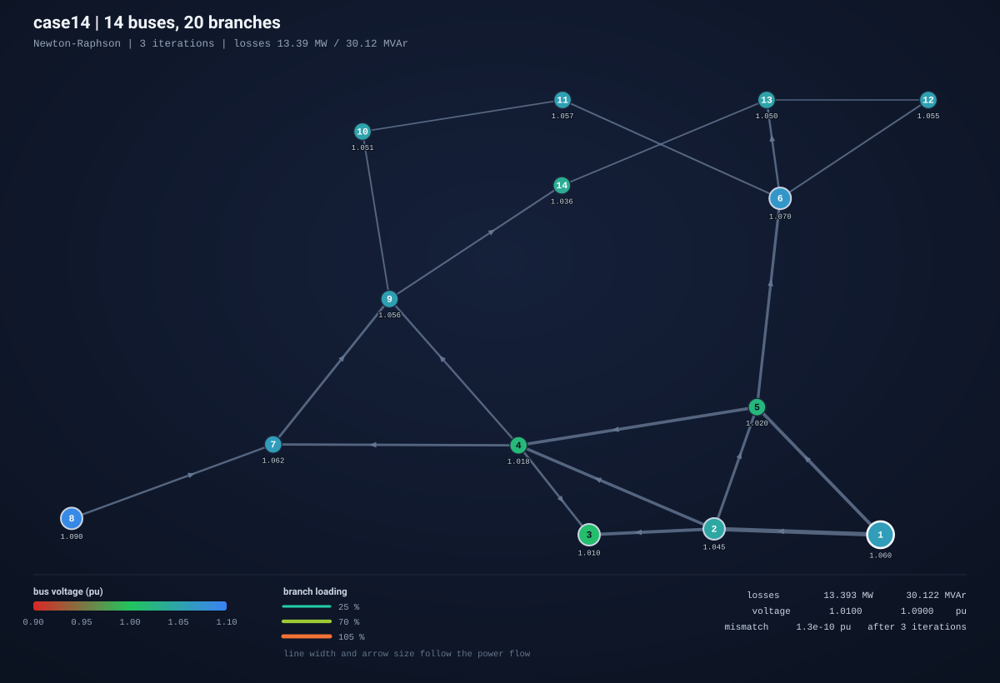
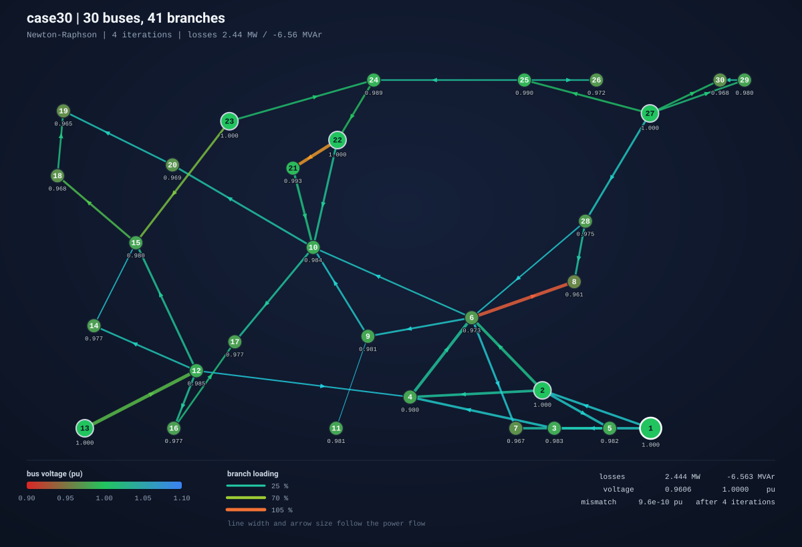
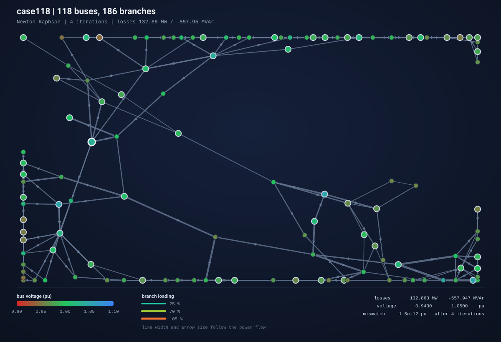

# PowerFlow

**电力系统潮流计算器** —— 用牛顿-拉夫逊法解交流潮流，读取 MATPOWER 格式的 IEEE 标准算例，
输出每个母线的电压相量、每条支路的潮流和全网网损，并生成一张可以直接放进 README 的单线图。

C++17 / CMake / 零第三方依赖。




<sub>这张图是程序自己用 `--svg` 生成的：母线颜色表示电压水平（越低越红，越高越蓝），
连线粗细表示潮流大小，颜色表示负载率，箭头是功率方向。没有手工排版，坐标由
Fruchterman-Reingold 弹簧算法算出来。</sub>

---

## 目录

- [这是什么](#这是什么)
- [能做什么](#能做什么)
- [快速开始](#快速开始)
- [输出示例](#输出示例)
- [算例与验证](#算例与验证)
- [算法](#算法)
- [一个真实的 bug](#一个真实的-bug)
- [项目结构](#项目结构)
- [测试](#测试)
- [设计取舍与已知局限](#设计取舍与已知局限)
- [数据来源](#数据来源)
- [许可证](#许可证)

---

## 这是什么

潮流计算是《电力系统分析》的核心问题：给定负荷和发电机出力，求电网的稳态运行点。

数学上它是一个非线性代数方程组 —— 每个 PQ 母线的有功、无功平衡方程，每个 PV 母线的有功
平衡方程 —— 未知量是各母线电压的幅值和相角。工程上几乎全部用牛顿-拉夫逊法求解，因为初值
合理时它具有平方收敛性：误差每迭代一次大致平方一次。

这个项目把那套流程完整实现了一遍，从读算例文件一直到画图。中间没有依赖 Eigen，也没有依赖
任何线性代数库：Y 矩阵组装、解析雅可比、带主元选取的 LU 分解全部手写。

## 能做什么

| 功能 | 说明 |
|------|------|
| 算例读取 | MATPOWER `.m` 格式的 `mpc.baseMVA` / `mpc.bus` / `mpc.gen` / `mpc.branch`，其它段落忽略。现成的 MATPOWER 算例可以直接用 |
| 牛顿-拉夫逊法 | 极坐标形式，解析雅可比，带部分主元的 LU 分解，平方收敛 |
| 高斯-赛德尔法 | 同一组方程的另一条迭代路径，留着做交叉验证和性能对比 |
| 变压器模型 | 串联阻抗 + 两端各一半的线路充电 susceptance + 理想变比（幅值和相移） |
| 无功限值 | `--enforce-q-limits` 把越限的 PV 母线转成 PQ 母线再解，直到不再越限 |
| 支路潮流与网损 | 逐支路两端功率、有功/无功损耗、负载率 |
| 输出 | 终端对齐报表、CSV（bus/branch/gen/summary 四张表）、JSON、SVG 单线图 |
| 输入校验 | 母线编号重复、支路指向不存在的母线、零阻抗支路、孤岛母线、slack 数量不为 1，都会给出带位置的错误信息 |

## 快速开始

### 在 CLion 里打开

1. `File → Open`，选中本仓库根目录（有 `CMakeLists.txt` 的这一层）。CLion 会把它识别成
   CMake 项目并自动 configure。
2. 如果提示选 Toolchain：Windows 上用 CLion 自带的 **MinGW**（`Settings → Build, Execution,
   Deployment → Toolchains` 里能看到 Bundled MinGW 即可），Linux / macOS 用系统编译器。
   要求：CMake ≥ 3.16、支持 C++17 的编译器。
3. `Run → Edit Configurations → + → CMake Application`：
   - Target 选 `powerflow`
   - Working directory 选项目根目录
   - Program arguments 填 `data/case14.m --svg ieee14.svg`
4. 直接运行。`powerflow_tests` 这个 target 也能直接运行，或者点单个 `TEST(...)` 左边的三角
   跑单条测试。

### 命令行

```bash
cmake -S . -B build -DCMAKE_BUILD_TYPE=Release
cmake --build build --parallel
ctest --test-dir build --output-on-failure      # 跑全部测试

./build/powerflow data/case14.m                 # 解 IEEE 14 节点
```

参数：

```
powerflow <case-file> [options]

  --method <nr|gs|both>   求解方法，默认 nr
  --tol <value>           收敛精度（标幺），默认 1e-8
  --max-iter <count>      迭代上限，默认 30（nr）/ 2000（gs）
  --enforce-q-limits      把越 Q 限的 PV 母线转成 PQ 母线
  --csv <directory>       导出 bus.csv / branch.csv / gen.csv / summary.csv
  --json <file>           导出完整结果 JSON
  --svg <file>            导出 SVG 单线图
  --no-tables             只打印摘要，不打印明细表
  -h, --help  /  --version
```

退出码：`0` 收敛，`1` 用法或数据错误，`2` 未收敛 —— 方便在脚本和 CI 里判断。

## 输出示例

```text
$ ./build/powerflow data/case14.m
case          : case14  (14 buses, 20 branches, 5 generators)
solver        : Newton-Raphson
status        : converged in 3 iterations, max mismatch 1.316e-10 pu
load          : 259.000 MW  /  73.500 MVAr
generation    : 272.393 MW  /  82.438 MVAr
losses        : 13.393 MW  /  30.122 MVAr
voltage range : 1.0100 .. 1.0900 pu

convergence: max |dP|, |dQ| in pu
iteration  |dP|,|dQ|     ratio
---------  ---------  --------
        1  4.218e-02         -
        2  5.669e-05  1.34e-03
        3  1.316e-10  2.32e-06

bus voltages and injections
Bus  Type  Vm (pu)  Va (deg)  Pgen (MW)  Qgen (MVAr)  Pload (MW)  Qload (MVAr)       Flag
---  ----  -------  --------  ---------  -----------  ----------  ------------  ---------
  1    SL   1.0600     0.000    232.393      -16.549       0.000         0.000
  2    PV   1.0450    -4.983     40.000       43.557      21.700        12.700
  3    PV   1.0100   -12.725      0.000       25.075      94.200        19.000
  4    PQ   1.0177   -10.313      0.000        0.000      47.800        -3.900
  5    PQ   1.0195    -8.774      0.000        0.000       7.600         1.600
  6    PV   1.0700   -14.221      0.000       12.731      11.200         7.500
  7    PQ   1.0615   -13.360      0.000        0.000       0.000         0.000  over-Vmax
  8    PV   1.0900   -13.360      0.000       17.623       0.000         0.000
  9    PQ   1.0559   -14.939      0.000        0.000      29.500        16.600
 10    PQ   1.0510   -15.097      0.000        0.000       9.000         5.800
 11    PQ   1.0569   -14.791      0.000        0.000       3.500         1.800
 12    PQ   1.0552   -15.076      0.000        0.000       6.100         1.600
 13    PQ   1.0504   -15.156      0.000        0.000      13.500         5.800
 14    PQ   1.0355   -16.034      0.000        0.000      14.900         5.000

generation by bus
Bus  Pg (MW)  Qg (MVAr)    Qmax     Qmin     Flag
---  -------  ---------  ------  -------  -------
  1  232.393    -16.549  10.000    0.000  at Qmin
  2   40.000     43.557  50.000  -40.000
  3    0.000     25.075  40.000    0.000
  6    0.000     12.731  24.000   -6.000
  8    0.000     17.623  24.000   -6.000
```

`ratio` 那一列是相邻两次失配的比值。进入平方收敛后，比值会连续掉好几个数量级 ——
这也是判断雅可比有没有写错的一个最直观信号（下面会讲，它真的抓到过东西）。

注意 9 号母线：它在数据里带一个 19 MVAr 的并联电容，所以该母线自身 `Qgen` 是 0
（它没有发电机），但全网需要的无功因此少了 21.18 MVAr。这就是"总发电无功 82.438"比
"负荷 73.5 + 网损 30.122"小的原因 —— 差额正好是电容贡献的那部分。

## 算例与验证

仓库自带五个 IEEE 标准算例（`data/`），全部收敛：

| 算例 | 母线 | 支路 | 牛顿迭代 | 有功网损 (MW) | 无功网损 (MVAr) | 高斯-赛德尔迭代 |
|------|-----:|-----:|---------:|--------------:|----------------:|----------------:|
| IEEE 9   | 9   | 9   | 5 | 4.6410   | -92.1601  | 159 |
| IEEE 14  | 14  | 20  | 3 | 13.3933  | 30.1224   | 63  |
| IEEE 30  | 30  | 41  | 4 | 2.4438   | -6.5627   | 514 |
| IEEE 57  | 57  | 80  | 4 | 27.8638  | 6.3280    | 325 |
| IEEE 118 | 118 | 186 | 4 | 132.8629 | -557.9474 | —   |

牛顿法三到五次迭代、高斯-赛德尔要一两百次，这就是两者的数量级差别。

IEEE 14 的有功网损 13.3933 MW 与公认结果 13.39 MW 一致；解出的母线电压与 IEEE Common
Data Format 文件里保存的标准解吻合到 1.3e-3 标幺、0.017°。9 节点和 118 节点的无功网损为负
是正常的 —— 这两个系统的线路充电功率大于网络的无功消耗。

更大的两个算例：

| IEEE 30 节点 | IEEE 118 节点 |
|---|---|
|  |  |

正确性不靠"看起来对"来保证，测试里有四条独立的对拍（细节见 [tests/README.md](tests/README.md)）：

1. **网损和电压**与一份独立的 Python/numpy 实现对拍，那份实现用有限差分雅可比、内部结构完全不同；
2. **解析雅可比**逐行逐列与中心差分数值微分核对（这是最容易写错的一环）；
3. **守恒关系**：所有母线注入之和 = 所有支路损耗之和 + 母线并联导纳吸收的功率；
4. **高斯-赛德尔法**与牛顿法给出同一组电压。

## 算法

**母线导纳矩阵。** 支路用 MATPOWER 的模型：串联阻抗 $z = r + jx$，两端各一半的线路充电
$b/2$，`from` 侧一个理想变比 $a = |a|e^{j\theta}$。

$$
Y_{ff} = \frac{y_s + jb/2}{aa^*}, \qquad
Y_{ft} = \frac{-y_s}{a^*}, \qquad
Y_{tf} = \frac{-y_s}{a}, \qquad
Y_{tt} = y_s + jb/2
$$

母线上的并联支路（`Gs` / `Bs`）加到对角元。

**牛顿-拉夫逊法。** 未知量是 PV/PQ 母线的相角和 PQ 母线的幅值，每次迭代解

$$
J \begin{bmatrix} \Delta\theta \\ \Delta V \end{bmatrix} =
\begin{bmatrix} P^{spec} - P^{calc} \\ Q^{spec} - Q^{calc} \end{bmatrix},
\qquad
P_i^{calc} = V_i \sum_j V_j \left(G_{ij}\cos\theta_{ij} + B_{ij}\sin\theta_{ij}\right)
$$

雅可比分四块，对角块用 $P_i$、$Q_i$ 的闭式表达：

$$
\frac{\partial P_i}{\partial \theta_i} = -Q_i - B_{ii}V_i^2, \qquad
\frac{\partial P_i}{\partial V_i} = \frac{P_i}{V_i} + G_{ii}V_i, \qquad
\frac{\partial Q_i}{\partial \theta_i} = P_i - G_{ii}V_i^2, \qquad
\frac{\partial Q_i}{\partial V_i} = \frac{Q_i}{V_i} - B_{ii}V_i
$$

非对角元是标准的 $V_iV_j(G\sin\theta_{ij} - B\cos\theta_{ij})$ 一类表达式，完整实现在
`include/powerflow/jacobian.hpp`。线性方程组用带部分主元的 LU 分解求解
（`include/powerflow/dense.hpp`）。

雅可比之所以单独做成一个公开头文件，就是为了让测试能够直接把它和有限差分对上 —— 而不是
只能从"程序收敛了"间接推测它没错。

**收敛判据**取失配向量的最大绝对值为准则，默认 $10^{-8}$ 标幺。

## 一个真实的 bug

这个项目里有意思的部分不是公式，而是下面这个过程。

初版实现跑通后，五个算例的结果都对上了参考值，测试全绿。但 `case57` 的收敛曲线不对劲：
其他算例都是平方收敛（比值 1e-3 → 1e-6），它却是**线性收敛**，比值稳定在 0.1 左右：

```
it 1  4.579e-01
it 2  7.679e-03   ratio 1.7e-02
it 3  9.596e-04   ratio 1.3e-01   <-- 卡住了
it 4  9.232e-05   ratio 9.6e-02
it 5  1.085e-05   ratio 1.2e-01
```

结果是"对的"（网损仍然与参考解一致），所以测试没有报警。但平方收敛退化成线性收敛，说明
牛顿步没有真正走到解上。

排查路径：

1. 怀疑雅可比写错 —— 对五个算例逐元素做有限差分核对，最大相对误差 4e-9，**不是它**。
2. 怀疑矩阵病态 —— 算了雅可比的条件数，`case57` 是 825，在五个算例里排第二低，**不是它**。
3. 怀疑线性求解器 —— 在迭代中途检查 $J\Delta x - f$ 的残差，发现它是 `7.6e-03`，而同一
   时刻 $\lVert f \rVert = 0.46$。以 $10^{-16}$ 的机器精度、条件数 825 计算，残差本该在
   $10^{-12}$ 量级。**线性方程组根本就没解准。**

于是问题定位到 LU 分解。用一个"良态但强制选主元"的构造来隔离（取一个对角占优矩阵，再随机
打乱它的行 —— 矩阵本身条件数不变，但不选主元就会撞上零主元）：

```
n=  4  rel_resid= 1.3e-16     <- 正常
n=  8  rel_resid= 5.9e-02     <- 坏了
n=181  rel_resid= 6.0e-02
```

根因在前代回代那一步。我写成了"按列"消去：处理到第 $k$ 步时，先交换右端项的第 $k$ 和
$p_k$ 行，然后立刻用 $x_k$ 去消去掉下面**所有**行的 $x_i$。而正确的顺序是"按行"：
**第 $i$ 行先完成自己的换位，再消去它自己**。

两者在只有一次换位时等价 —— 所以 `2×2`、`3×3` 的测试都过，`case14` 也过（它的雅可比
碰巧不需要触发多次换位）。一旦出现两次以上主元交换，"按列"版本就会拿一个"稍后会被换走"
的右端项去做消去，把解算错。在电力系统里这不会报错，只会让牛顿法悄悄退化成线性收敛。

修正（`dense.hpp`）就是把前代改成按行：

```cpp
for (std::size_t i = 0; i < n_; ++i) {
    if (pivot_[i] != i) std::swap(x[i], x[pivot_[i]]);
    Scalar acc = x[i];
    for (std::size_t j = 0; j < i; ++j) acc -= lu_(i, j) * x[j];
    x[i] = acc;
}
```

改完之后 `case57` 从 7 次迭代降到 4 次，恢复平方收敛（比值 1.2e-02 → 9.7e-04 → 6.6e-07），
五个算例的网损一个数字都没变。回归测试
`Dense.SolvesPermutedSystemThatNeedsManyPivots`（37×37、随机行置换、检查相对残差）
现在把这个坑焊死了。

这个 bug 值得留在 README 里，因为它说明了两件事：一是"结果对"和"算法对"不是一回事；
二是像条件数、收敛比值这些**诊断量**比最终数字更能说明程序在干什么。

## 项目结构

```
powerflow/
├── CMakeLists.txt
├── include/powerflow/
│   ├── types.hpp          母线 / 发电机 / 支路的数据结构
│   ├── dense.hpp          稠密矩阵与带主元的 LU 分解（header-only）
│   ├── case_file.hpp      MATPOWER 算例读取
│   ├── network.hpp        母线分类、Y 矩阵组装
│   ├── jacobian.hpp       解析雅可比（单独暴露，便于有限差分验证）
│   ├── power_flow.hpp     牛顿-拉夫逊 / 高斯-赛德尔
│   ├── report.hpp         终端报表、CSV、JSON
│   └── svg_renderer.hpp   SVG 单线图
├── src/                   对应实现 + main.cpp
├── tests/                 单元测试与集成测试（自带极简测试框架）
├── data/                  五个 IEEE 标准算例
└── docs/figures/          生成的图
```

## 测试

```bash
ctest --test-dir build --output-on-failure
```

61 条单元/集成测试、1000 余条断言，外加 CTest 里注册的 7 条命令行冒烟测试（`--help`、
`--json`、`--csv`、`--svg`、`--method both` 等）。测试框架是自己写的一百多行头文件，
不引入 gtest / catch2。

CI 在 GitHub Actions 上跑四个组合：Ubuntu + GCC（开 `-Werror`）、Ubuntu + Clang、
macOS + AppleClang、Windows + MSVC。

## 设计取舍与已知局限

**为什么不用 Eigen。** 不是逞强。最大算例 118 母线，雅可比是 181×181 的实数矩阵，稠密 LU
在这个规模上完全不是瓶颈。手写的收益是：编译零配置、任何环境 `cmake && make` 就能跑，
而且线性代数部分本身变成可以在测试里逐条验证的代码，而不是黑盒 —— 上面那个 bug 正是这样
被抓住的。

**为什么还留着高斯-赛德尔。** 它慢两个数量级，工程上没有实用价值。留着是因为它用完全不同
的迭代路径算出同一组电压，是一个很便宜的交叉验证手段。

**已知局限。**

- 只做潮流，不做最优潮流、短路计算、暂态稳定。`mpc.gencost` 读进来就丢掉了。
- 稠密矩阵、$O(n^3)$ 的 LU，几千母线以上会明显变慢；要往上走应该换稀疏 LU 加节点编号优化。
- 没有处理 PV 母线电压越界后的变压器抽头调整，也没有连续的无功优化。
- 单相正序模型，不含三相不平衡。
- 孤岛处理是保守的：母线无在运支路就判为孤岛并排除在方程之外，不做多孤岛分别求解。
- `--enforce-q-limits` 用的是"越限就钉在限值上重解"的朴素做法，不做启发式的限值恢复。

## 数据来源

`data/` 下的五个算例是公开的 IEEE 基准数据，数值来自 University of Washington 的
Power Systems Test Case Archive（IEEE Common Data Format），经 MATPOWER 转成 MATPOWER
布局。仓库里只保留数值本身并重写了文件头，没有复制第三方源码文本。详见
[data/README.md](data/README.md)。

## 许可证

[MIT](LICENSE)。
